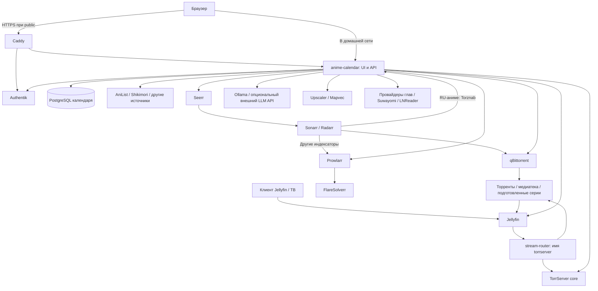

# Архитектурный анализ Home Theater

Дата: 11 ноября 2026 года. Основание: исходный код, SQL-миграции, Docker Compose, скрипты настройки и восстановления, тестовые конфигурации. Это статический анализ текущего рабочего дерева: доступность сервисов, фактически включённые профили, содержимое рабочей базы и производительность запущенной системы не проверялись. Секреты `.env` не читались.

## 1. Основной вывод

Проект представляет собой персональную медиаплатформу с собственным управляющим приложением. Исходная связка Jellyfin + *arr выросла в систему, объединяющую каталог аниме, автоматическое получение контента, потоковый просмотр, чтение манги и ранобэ, социальные сценарии и накопление знаний о произведениях.

Её архитектура имеет два уровня:

1. **Сервисная композиция:** готовые Docker-сервисы выполняют специализированную работу — загрузки, поиск по трекерам, медиатека, транскодирование, идентификация, инференс моделей.
2. **Модульный монолит `anime-calendar`:** один Next.js-сервис содержит интерфейс, API, бизнес-правила, интеграции, обработчики задач и периодические задания.

Название `anime-calendar` уже существенно уже его фактической ответственности. Это основной центр координации проекта. При этом Jellyfin остаётся центром доставки видео, а Sonarr/Radarr — центрами постоянной медиатеки.

Масштаб `apps/anime-calendar/src` на момент анализа: **543 файла TypeScript/TSX**, включая **70 тестовых файлов**, **52 774 строки** вместе с тестами, **133 API-маршрута**, **43 страницы**, **106 TSX-файлов компонентов**, **118 серверных модулей без тестов**. Начальная миграция PostgreSQL создаёт **89 прикладных таблиц**. Эти числа характеризуют объём структуры, а не покрытие тестами или сложность каждой функции.

## 2. Общая схема взаимодействий



Стрелки обозначают основные обращения и потоки, а не полный перечень сетевых соединений. Поток браузерного видео проходит через API календаря и Jellyfin; схема не означает прямого доступа браузера к ключам сервисов.

Важная особенность: связи не образуют простую линейную цепочку. Например, календарь запрашивает загрузку через Seerr, а Sonarr затем обращается обратно к календарю как к индексатору русских раздач.

## 3. Карта репозитория

| Область | Роль | Главные связи |
|---|---|---|
| `docker-compose.yml`, `compose.*.yml` | Топология сервисов, тома, порты, GPU, VPN, внешняя БД, тестовый контур | Все приложения и сторонние контейнеры |
| `scripts/` | Создание окружения, настройка через API, импорт пользовательских списков, backup/restore | Compose, `.env`, API готовых сервисов |
| `profiles.toml`, `recyclarr/` | Приоритеты студий, озвучек и качества | Bootstrap, Sonarr/Radarr, RU-релизы в календаре |
| `apps/anime-calendar/src/app` | Страницы App Router и HTTP API | Компоненты и серверные домены |
| `src/components` | Пользовательские сценарии и визуальные блоки | Клиентские хуки, общие типы и правила |
| `src/lib` | Типы, алгоритмы, правила и клиентские утилиты | UI и сервер; не все файлы здесь являются чистыми функциями |
| `src/server` | Предметная логика, SQL, интеграции, задачи | PostgreSQL, внешние API и файловая система |
| `database/`, `migrations/` | Адаптер PostgreSQL, миграции, перенос SQLite, backup/restore | Доменный SQL и запуск приложения |
| `apps/stream-router` | Выбор между подготовленным файлом и TorrServer | Jellyfin, `.prep/index.json`, общий том |
| `apps/upscaler` | Изолированный сервис Real-ESRGAN | Кэш изображений календаря, GPU/CPU |
| `apps/mapvec` | OCR и векторизация карт | Карта мира, распознавание текста страниц манги |
| `apps/caddy`, `apps/ddns` | Публичный HTTPS, маршрутизация, обновление DuckDNS | Authentik и веб-сервисы |
| `docs/`, `TASKS.md`, `IDEAS.md`, `CLAUDE.md` | Исследования, решения, планы, контекст разработки | Полезны для намерений, но требуют сверки с кодом |

## 4. Сервисы и распределение ответственности

### 4.1. Получение и хранение видео

- **Seerr** — поиск и запросы фильмов/сериалов, промежуточный доступ к данным TMDB. В своём приложении он используется и как часть интерфейса заказа контента, и как поставщик метаданных.
- **Sonarr** — сериалы и аниме: мониторинг серий, выбор релиза, импорт и организация файлов.
- **Radarr** — аналогичная ответственность для фильмов. Специальный RU-адаптер календаря ориентирован на аниме для Sonarr; переносить его описание на весь видеокаталог нельзя.
- **Prowlarr** — подключения и запросы к трекерам. **FlareSolverr** помогает с защищёнными страницами; календарь также использует его в обработке RU-тем.
- **qBittorrent** — постоянные загрузки для *arr и отдельный сценарий подготовки выбранного файла раздачи для просмотра.
- **Bazarr** — получение субтитров для постоянной медиатеки.
- **Recyclarr** — инструмент конфигурации профилей качества; это не обязательный постоянно работающий участник просмотра.

Единый `${DATA_ROOT}` монтируется как `/data` в сервисах, работающих с загрузками. `torrents/*` и `media/*` должны находиться в пределах файловой системы, допускающей hardlink: тогда файл остаётся на раздаче и появляется в медиатеке без второй копии. Размещение на разных файловых системах меняет экономику хранения и скорость импорта.

### 4.2. Доставка видео

- **Jellyfin** индексирует библиотеку и `.strm`, выбирает способ воспроизведения, отдаёт прямой поток или транскодирует его. Собственный плеер не заменяет эту серверную часть.
- **TorrServer core** получает данные торрента по мере просмотра и держит ограниченный буфер. Он не равнозначен постоянной загрузке в медиатеку.
- **Stream-router** слушает внутреннее имя `torrserver:8090`. Для подготовленного файла отдаёт локальные байты с HTTP Range; остальные запросы проксирует в `torrserver-core`.
- **Календарь** формирует источники, создаёт сессии, проксирует обращения браузера, сохраняет позицию и связывает просмотр с пользовательскими списками.

Это три разных состояния контента: **постоянная библиотека**, **временный поток**, **подготовленная серия на диске**. У них разные правила готовности и очистки. `server/availability.ts` собирает их в общую модель для интерфейса.

### 4.3. Инфраструктура и доступ

Базовый Compose задаёт домашнюю установку. Профиль `public` добавляет Caddy, DDNS, Authentik, его worker и отдельную PostgreSQL. `compose.nvidia.yml` подключает GPU к Jellyfin, Ollama, Mapvec и Upscaler; `compose.intel.yml` настраивает устройство Intel для Jellyfin. Это разные варианты ускорения, а не взаимозаменяемое ускорение всех ИИ-функций.

Профили `upscaler`, `mapvec`, `suwayomi` добавляют необязательные возможности. `compose.external-db.yml` убирает требование локального PostgreSQL календаря. VPN-оверрайд использует Gluetun для qBittorrent; из него не следует, что TorrServer и все остальные контейнеры автоматически защищены тем же туннелем.

## 5. Внутреннее устройство основного приложения

### 5.1. Технологический стек и путь запроса

Фактические зависимости: Next.js 16, React 19, TypeScript, Tailwind CSS 4, TanStack Query 5, iron-session; серверные `pg`, Synckit, node-pg-migrate, Sharp, Cheerio/htmlparser2; видеоплеер hls.js и JASSUB 1.8.8; графы Graphology, Louvain, ForceAtlas2 и Sigma 3. Версии приведены по `package.json`, где часть зависимостей задана диапазонами; присутствует `package-lock.json`.

Типичный путь:

```text
Страница App Router
  → компонент View
  → хук TanStack Query / api() из lib/client.ts
  → app/api/.../route.ts
  → authed() и предметные проверки доступа
  → server/<домен>.ts
  → lib/<правила>.ts + SQL / внешний API / файловый артефакт
```

`(app)/layout.tsx` проверяет пользователя до отображения оболочки. `server/route.ts` задаёт общую проверку сессии, формат ошибок и заголовок устаревших данных; `adminOnly()` ограничивает служебные операции. Приватность профиля и списков — отдельная предметная проверка через `social-rules.ts`, а не следствие самого факта входа.

TanStack Query отвечает за клиентский кэш, опрос состояния и оптимистичные изменения. Например, список меняется сразу, а при ошибке восстанавливается. `lib/entry-rules.ts` используется и клиентом, и сервером: переходы статусов не приходится независимо воспроизводить в двух местах.

### 5.2. Предметные подсистемы

| Подсистема | Опорные файлы | Ответственность |
|---|---|---|
| Каталог и календарь | `anilist.ts`, `shikimori.ts`, `search.ts`, `lib/schedule.ts`, `components/calendar/` | Расписание, поиск, фильтры, локализация, оценки |
| Пользовательская библиотека | `lists.ts`, `sync.ts`, `anilib.ts`, `animego-import.ts` | Статусы, прогресс, впечатления, импорт и синхронизация |
| Согласование идентификаторов | `idmap.ts`, `ru/identify.ts`, `ru/episode.ts` | AniList/MAL/AniDB/TMDB/TVDB и нумерация серий |
| Русские релизы | `ru/torznab.ts`, `releases.ts`, `parse*.ts`, `topic*.ts`, `arr.ts`, `importer.ts` | Поиск, разбор, нормализация, выбор и импорт |
| Просмотр | `stream.ts`, `playback.ts`, `availability.ts`, `player.ts`, `prep.ts`, `prebuffer.ts`, `qbit.ts` | Источники, готовность, буфер, сессии и подготовка |
| Субтитры и вспомогательное видео | `stream-subs.ts`, `stream-voices.ts`, `sdh.ts`, `signs.ts`, `frame-text.ts`, `segments.ts`, `thumbs.ts` | Дорожки, перевод, опенинги, кадры и превью |
| Социальные функции | `social.ts`, `comments.ts`, `together.ts`, `rooms.ts`, `groups.ts`, `achievements.ts` | Друзья, видимость, обсуждения, списки, совместный просмотр |
| ИИ и рекомендации | `llm*.ts`, `knowledge.ts`, `reco/*` | Провайдеры моделей, знания, вкус, ранжирование, карта тайтлов |
| Сюжетные знания | `plot*.ts`, `corpus-store.ts`, `characters.ts`, `franchise.ts`, `glossary.ts` | Корпус, пересказ, события, персонажи, места, франшизы, термины |
| Манга и ранобэ | `books/*`, `components/books/*` | Источники, главы, чтение, переводы, рекомендации |
| Жизненный цикл данных | `cache.ts`, `sources.ts`, `archive.ts`, `img-cache.ts`, `books/pages-cache.ts` | Сохранение, обновление, деградация и очистка |
| Фоновая координация | `instrumentation.ts`, `jobs.ts`, `tasks.ts`, `notifications.ts` | Периодические операции, очереди и обратная связь |

Это логические границы, а не изолированные пакеты. Модули напрямую вызывают друг друга и используют общую БД. По приблизительному статическому подсчёту импортов, без тестов, `server/db.ts` импортируется из 73 файлов, `server/cache.ts` — из 42, `server/anilist.ts` — из 41, `server/lists.ts` — из 30, `server/tasks.ts` — из 28. Счётчик учитывает также импорты типов и не является измерением частоты вызовов.

Среди узлов с большим количеством зависимостей: `AnimeDetailsView.tsx`, `jobs.ts`, `WatchView.tsx`, `plot.ts`, `plot-graph-build.ts`. Они отражают места сборки пользовательского опыта и междоменной координации.

## 6. Данные и источники истины

### 6.1. Источник истины распределён по предметным областям

| Данные | Главный владелец | Локальная роль календаря |
|---|---|---|
| Расписание и базовый каталог | AniList | Снимки и долговременный кэш |
| Русские названия, описания, дополнительные оценки | Shikimori и другие источники | Обогащение карточки |
| Файлы постоянной медиатеки | Файловая система + Sonarr/Radarr | Поиск соответствий и отображение готовности |
| Медиаэлементы и транскодирование | Jellyfin | Привязка к аниме/серии, сессия браузера, прокси |
| Впечатления, приватность, социальные связи | PostgreSQL календаря | Основная запись |
| Статус и прогресс списков | Локальная запись + синхронизация с привязанными сервисами | Dirty-флаги, удалённые ID, согласование изменений |
| Идентичность при SSO | Authentik | Локальный пользователь, роли и привязка к Jellyfin |
| Сгенерированные знания и ручные исправления | БД календаря | Журнал происхождения, выбор результата, предметные проекции |
| Тексты и изображения глав | Провайдеры глав | Кэш содержания и страниц, позиция чтения |

PostgreSQL календаря не объединяет базы всего стека: Authentik имеет собственную PostgreSQL, остальные приложения сохраняют свои конфиги и базы. Наличие общей Docker-сети не означает общую транзакцию между сервисами.

### 6.2. PostgreSQL с синхронным контрактом

`server/db.ts` переэкспортирует `db-postgres.ts`. Доменный код сохранил интерфейс `prepare().get/all/run`, `exec` и синхронные транзакции. Сетевые операции выполняются через Synckit-worker `database/pg-worker.mjs` и выделенное соединение `pg` на процесс. `database/sql.mjs` преобразует placeholders `?` в PostgreSQL-параметры; это не универсальный переводчик SQLite SQL.

Плюс решения — минимальная перестройка существующего кода, единое соединение транзакции, savepoints для вложенности. Цена — **ожидание БД блокирует вызывающий поток**, хотя сеть вынесена в worker. Переход на PostgreSQL сам по себе не сделал доменную работу асинхронной и не добавил пул параллельных запросов. Высокая задержка внешней БД особенно существенна для операций со множеством последовательных SQL-вызовов.

Миграции выполняются до старта HTTP и фоновых работ. Перенос старой SQLite проверяет целостность данных; SQLite-код оставлен для legacy-сценариев и тестов. Возврат `DATABASE_DRIVER=sqlite` не переносит обратно новые записи из PostgreSQL.

### 6.3. Основные группы таблиц

- **Пользователь и активность:** `users`, `list_entries`, `read_entries`, `playback_pos`, `read_pos`, `watch_log`, `user_taste`, `user_achievements`.
- **Социальные отношения:** `friendships`, `comments`, `shared_lists*`, `watch_sessions`, `watch_events`, `watch_rooms`, `watch_room_members`, `group_*`, `invites`, `signup_requests`.
- **Архив и фон:** `media`, `cache`, `archive_queue`, `archive_state`, `tasks`, `notifications`, `episode_marks`, `chapter_marks`.
- **ИИ:** `llm_output`, `llm_usage`, `anime_profile`, `anime_plot`, `theme_canon`, `app_settings`.
- **Предметный граф:** `plot_entity`, `plot_identity`, `plot_name`, `plot_alias`, `plot_relation`, `plot_event*`, `plot_place*`, `plot_map*`, `plot_appearance`, `plot_view`, `plot_edit` и связанные таблицы.
- **Чтение и локализация:** `book_links`, `book_chapters`, `chapter_content`, `chapter_body`, `book_source_state`, `book_ai`, `book_pref`, `glossary_*`.
- **Медиаподготовка:** `prepared_files`, `release_subs`, `sdh_file`, `episode_segments`, `episode_fp`, `img_cache`, `img_upscale`, `voice_pref`.

В схеме есть отложенные внешние ключи с каскадным удалением для ряда пользовательских и социальных сущностей. Межсервисные и внешние идентификаторы остаются прикладными связями: PostgreSQL не может проверить, существует ли серия в Jellyfin или раздача на трекере.

## 7. Неочевидные связи и решения

### 7.1. Нормализация идентичности — фундамент всей платформы

Один сезон AniList не обязательно совпадает с сезоном TVDB/TMDB. `idmap.ts` объединяет Fribb anime-lists и Anime-Lists XML, сохраняя сезон и смещение серий. Например, серии 1–12 второй части могут соответствовать TVDB S02E13–24.

От этого зависят заказ в Seerr, поиск Sonarr, разбор релиза, имена `.strm`, поиск файлов Jellyfin, импорт и обратная синхронизация прогресса. Ошибка здесь может выглядеть как проблема совершенно другого компонента: «не та серия», «не находится озвучка», «просмотр не засчитался». Это сквозной домен согласования, а не вспомогательная таблица ID.

### 7.2. Календарь одновременно клиент и поставщик Sonarr

Для русских аниме-раздач Sonarr вызывает Torznab API календаря. Календарь обращается к Prowlarr, разбирает заголовки и описания тем, определяет студии, сезон и диапазон серий и выдаёт нормализованный релиз обратно Sonarr.

Таким образом, приложение работает как слой совместимости между человеческими названиями русских раздач и моделью данных Sonarr. Периодический помощник импорта продолжает эту работу уже после скачивания, когда имена файлов внутри торрента не подходят стандартному распознаванию.

### 7.3. Файлы и Docker DNS являются частью API

`.strm`, структура папок с `[tvdbid-X]`, внешние `.mka`, `.prep/index.json`, кэш `.torrent` и имя `torrserver` — не просто детали размещения. Это контракты между независимыми программами.

В частности, Jellyfin может сохранить уже прочитанный адрес `.strm`. Поэтому проект меняет источник байтов за постоянным адресом: `stream-router` по индексу подготовленных файлов решает, читать диск или TorrServer. Это устраняет необходимость заставлять Jellyfin перечитывать ссылки.

Следствие: изменение БД без согласованного изменения файлов и индекса может оставить устаревшие состояния. `cleanupPrepared()` и другие восстановительные проходы здесь выполняют роль согласования проекций.

### 7.4. Просмотр — источник событий для нескольких систем

Плеер сохраняет позицию в `playback_pos`; после достижения порога просмотренности вызывает `markWatched`. Просмотры из внешних клиентов Jellyfin поступают через периодический `jellyfin-sync`.

Оба пути сходятся к `upsertEntry`: применяются правила статуса и прогресса, планируется отправка в Shikimori, пишется активность, вызывается логика совместного просмотра. Ручной API изменения списка дополнительно запускает архивирование нового тайтла и пересчёт достижений после ответа.

Это система с эффектами от событий, но **без единой шины событий**: эффекты запускаются прямыми вызовами, отложенными импортами, `after()` и таймерами. Нельзя предполагать, что любой путь изменения списка автоматически выполняет один и тот же полный набор эффектов.

### 7.5. Прогресс и знание сюжета разделены

`plot_view` и курсор зрителя позволяют показать сюжет на выбранную серию, не меняя реальный прогресс просмотра. По умолчанию представление связано с просмотренным, но пользователь может выбрать другой режим.

Граф хранит не только сущность, но и момент раскрытия имени, личности, отношения, события или облика. Серверные выборки учитывают курсор; это влияет сразу на персонажей, события, имена в тексте, отношения и места. Таким образом, защита от спойлеров — свойство модели данных и выдачи API.

### 7.6. Здесь несколько принципиально разных графов

1. **Граф рекомендаций/карта тайтлов:** сходство произведений, вкусы, кластеры, раскладка и навигация.
2. **Граф франшизы:** сезоны, продолжения, ответвления, первоисточники и экранизации.
3. **Граф сюжета:** персонажи, события, отношения, личности и раскрытия по сериям.
4. **Карта мира:** места, координаты и картографическое изображение/векторы.

Они связаны, но имеют разные рёбра, критерии корректности и правила доступа. Слово «граф» в названии файла не гарантирует принадлежность к одной подсистеме.

### 7.7. Глоссарий превращает независимые переводы в связанную систему

`glossary.ts` выбирает корень франшизы, собирает термины из персонажей и сюжетных данных, поддерживает ручное закрепление. Книга с экранизацией может использовать глоссарий её аниме-франшизы.

Этот словарь используется для переводов глав, серий, надписей и текста кадра. Новые предложенные моделью термины пополняют ту же систему. Поэтому качество сведений о персонажах влияет на единообразие чтения и просмотра; ручная правка термина имеет последствия за пределами текущей страницы.

### 7.8. Mapvec используется шире своего названия

Сервис обслуживает не только векторизацию карт: OCR `/lines` используется переводом манги. Отключение `mapvec` оставляет базовый просмотр карт и чтение, но влияет также на генерацию переводного слоя манги. Готовые сохранённые результаты следует отличать от возможности создать новые.

### 7.9. ИИ-выходы являются долговременными знаниями

`knowledge.ts` сохраняет результаты в `llm_output` с моделью, провайдером, рангом, хэшем входа и версиями схемы/промпта. Выбор лучшего результата отделён от генерации. Старый качественный ответ не обязан исчезать при недоступности модели или изменении промпта.

`anime_profile`, `anime_plot` и `user_taste` служат предметными проекциями этих знаний. Эмбеддинги используются локально, а рекомендации совмещают теги, векторное сходство, признаки разбора и сигналы пользователя. ИИ не является единственным ранжирующим механизмом.

Глубокий пересказ обрабатывает серии порциями; хэш порции зависит от предыдущей. Изменение раннего источника может потребовать пересчитать последующую цепочку, а добавление новой серии — только хвост.

### 7.10. Кэш выполняет роль личного архива

`cache.ts` разделяет `entity`, `listing`, `volatile`. Срок означает время повторной проверки; сущности не удаляются по обычному истечению TTL. Устаревшее можно немедленно отдать и обновить в фоне. `sources.ts` временно прекращает обращения к падающему источнику; `archive.ts` целенаправленно сохраняет содержимое тайтлов, включая данные списков.

Это повышает автономность, но не делает всю систему полностью офлайн: незнакомый тайтл, непрочитанная глава или отсутствующий видеофайл по-прежнему требуют источника. Доступность страницы с метаданными не означает доступность воспроизведения.

### 7.11. GPU делится между разными пользовательскими сценариями

Ollama, Jellyfin, Mapvec и Upscaler могут использовать один физический GPU. В `upscale.ts` есть ожидание освобождения Ollama, Python-сервисы сериализуют свои тяжёлые операции локальными блокировками. Но это не единый планировщик всего GPU.

Следствие из топологии: перевод, анализ, апскейл и транскодирование способны конкурировать за ресурсы. Фактический масштаб конкуренции зависит от оборудования и нагрузки; измерений в рамках этого анализа нет.

## 8. Ключевые сценарии использования

### 8.1. Открыть календарь и найти аниме

**Участники:** CalendarView/MonthGrid/WeekView/AgendaView → клиентские хуки → `/api/calendar`, `/api/browse`, `/api/search` → AniList/Shikimori → cache/sources → PostgreSQL.

Приложение получает расписание, обогащает названия и оценки, применяет общие правила представления; фильтры сохраняются в URL. Периодический прогрев текущего и следующего месяца снижает число холодных обращений. Списки пользователя накладываются на каталог, но внешний каталог и личная библиотека остаются разными данными.

### 8.2. Запросить аниме в постоянную библиотеку

**Участники:** RequestButton → API Seerr календаря → idmap → Seerr → Sonarr → Torznab календаря/Prowlarr → qBittorrent → импорт Sonarr → Jellyfin; при необходимости Bazarr и `extra-tracks.sh`.

Сначала нужно согласовать тайтл и сезон. Sonarr выбирает релиз по качеству и баллам `profiles.toml`; RU-адаптер раскрывает студии, которые могут находиться только в описании темы. После загрузки выполняется импорт и создание библиотечного файла; помощник календаря разбирает сложные имена эпизодов. Внешние дорожки могут размещаться рядом с видео. Этот сценарий строит долговременную медиатеку.

### 8.3. Выбрать конкретную озвучку и скачать релиз

**Участники:** VoicesButton → `/api/ru/releases/*`, `/api/tasks` → tasks → ru/releases/topic/profiles → Prowlarr/FlareSolverr → ru/arr → Sonarr.

Поиск оформлен фоновой задачей: повторный запрос присоединяется к существующему, ручной получает приоритет, результат сохраняется и сопровождается уведомлением. Выбор релиза направляет его в Sonarr; это отличается от автоматического запроса «найти лучший» через Seerr.

### 8.4. Смотреть сейчас без полной загрузки

**Участники:** VoicesButton → API stream → `stream.ts` → Prowlarr → TorrServer → `.strm` → обновление Jellyfin → WatchView/Player → `/api/play/*` → Jellyfin → stream-router → TorrServer.

Получив торрент и сопоставив файлы сериям, календарь создаёт элементы потоковой библиотеки. Jellyfin индексирует их; браузер получает подходящий поток через сервер календаря. Готовность оценивается по источникам и буферу, а не только по наличию карточки в Jellyfin. hls.js воспроизводит HLS, JASSUB рисует ASS; сервер сохраняет позицию и завершает брошенные сессии.

### 8.5. Подготовить серию и автоматически готовить следующую

**Участники:** интерфейс серий/группа просмотра → tasks/prebuffer/prep → qBittorrent → `/stream/.prep` → `prepared_files` + `.prep/index.json` → stream-router → Jellyfin; очистка в jobs.

Скачивается выбранный файл раздачи. Маршрутизатор начинает отдавать его с диска по прежнему адресу. Подготовка следующей серии учитывает активный просмотр; выбранная студия сохраняется в `voice_pref` и участвует в подготовке дорожек. Лимит места и очистка ограничивают временное хранение. Подготовленный файл не равнозначен импорту в постоянную библиотеку Sonarr.

### 8.6. Досмотреть серию и продолжить с другого устройства

**Участники:** Player → reportProgress/playback_pos → markWatched → lists/applyProgress → watch_log + together → очередь sync → Shikimori. Альтернативный вход: ТВ-клиент Jellyfin → периодический jellyfin-sync → та же предметная отметка.

В плеере порог просмотренности — 85% (`WATCHED_SHARE`). Прогресс влияет на статус, счётчик серий и сюжетный курсор. Отправка в Shikimori откладывается на несколько секунд и сериализуется; при ошибке dirty-запись остаётся для последующей синхронизации. Для собственных доступных пользователю Jellyfin-элементов позиция также записывается в Jellyfin.

### 8.7. Посмотреть вместе с друзьями

**Участники:** friends/shared lists → together/groups → groupTick → подготовка серии и уведомления → rooms → SSE `/api/rooms/[rid]/events` → useRoom/RoomPanel → отдельные сессии Player/Jellyfin участников.

Общий список становится основой группы: очередь тайтлов, голосования, запланированные сеансы, пресеты и управление. Комната синхронизирует команды и состояние по серверному времени, учитывает ожидание участников и буферизацию. SSE передаёт управляющие события, а не видеобайты; у участников собственное воспроизведение. Отдельно поддерживается совместная отметка просмотра на одном экране через `watch_sessions`/`watch_events`.

### 8.8. Получить рекомендации и изучить карту тайтлов

**Участники:** Impressions/списки → reco/profile → AniList/Shikimori → llm/knowledge/Ollama → эмбеддинги и признаки → reco/math/engine/card → RecommendationsView; для карты reco/graph/atlas → Graphology/Louvain/ForceAtlas2 → Sigma.

Оценки, статусы, заметки, личные теги и предпочтения озвучки задают вкус. Алгоритм собирает кандидатов и считает гибридную релевантность; LLM формирует портрет, объяснения и переранжирование при доступности. Локальные сохранённые профили используются повторно. Отсутствие чат-модели и отсутствие модели эмбеддингов дают разные режимы деградации.

### 8.9. Разобраться в сюжете без лишних спойлеров

**Участники:** PlotHub/Characters/Events/RelationMapView/Places → plot/corpus/deep/graph-build → внешние описания и тексты серий → llm_output и plot_* → cursor-фильтрация → UI.

Сначала собирается корпус, затем формируются пересказы и структурированные факты. Сервер выбирает доступные пользователю раскрытия. Ручные исправления проходят через `plot-edits`; карта мира может использовать Mapvec. Исследование связанной франшизы и сопоставление экранизации с главами включают `franchise`, `adapt` и `plot-align`.

### 8.10. Читать мангу или ранобэ и переводить отсутствующие главы

**Участники:** BooksHome/BookView → AniList books/trackers → books/library → Provider → book_links/book_chapters → Reader/MangaReader → chapter_content/pages-cache → reading/read_pos/read_entries → sync.

Общий интерфейс Provider поддерживает поиск, оглавление, содержание и проверку доступности. Подключены RanobeLib, MangaLib, MangaDex, Syosetu, мосты LNReader и Suwayomi. Результат главы бывает текстом, набором страниц или внешней ссылкой. Автоматическое сопоставление учитывает ID, названия и издание; ручные привязки и скрытые неверные совпадения сохраняются.

Для ранобэ перевод идёт кусками с контекстом и глоссарием, сохраняется в `llm_output` и появляется как AI-вариант главы. Для манги Mapvec распознаёт строки, приложение группирует реплики, переводит текст и рисует слой поверх оригинала. Позиция страницы/абзаца и факт прочтения сохраняются отдельно; завершение главы может обновить список и отправить прогресс в Shikimori.

### 8.11. Пригласить пользователя и дать доступ

**Участники:** InvitePanel/AccountsView → accounts → Authentik API → syncSignups → решение администратора → локальный users + Jellyfin + friendships; при входе OIDC state/PKCE → userinfo → iron-session.

Календарь управляет жизненным циклом пользователя сразу в нескольких системах. Одобрение приглашённого связывает его с пригласившим. Authentik задаёт внешнюю идентичность, локальная БД — прикладное состояние и блокировку, Jellyfin — права на медиатеку. В домашнем режиме предусмотрен вход через Jellyfin без настроенного SSO.

### 8.12. Развернуть, перенести или восстановить систему

**Участники:** init → `.env`/каталоги → Compose → bootstrap → API всех сервисов; prepare/migrate/import для БД; backup/restore для конфигурации и дампов.

`init.py` готовит окружение, а `bootstrap.py` настраивает связи через API: download clients, индексаторы, профили, библиотеки, запросы, TorrServer, модели и SSO. Следовательно, Compose-файлы сами по себе не описывают всю рабочую конфигурацию.

Backup календаря создаёт PostgreSQL dump до остановки сервисов; далее архивируются конфиги и `.env`. Медиатека переносится отдельно с сохранением hardlink. Это восстановление нескольких самостоятельных хранилищ, а не одна транзакция всей платформы.

## 9. Фоновые работы и устойчивость

`instrumentation.ts` запускает `jobs.startJobs()` в Node runtime. Расписание находится внутри процесса приложения:

| Частота | Примеры работ |
|---|---|
| 20–30 секунд | Архивная очередь, подготовка следующей серии |
| 1–2 минуты | Группы, регистрации, очистка брошенных сессий, RU-импорт |
| 5–15 минут | Просмотры Jellyfin, новые серии, обновление списков и Shikimori |
| 30–60 минут | AniLib, озвучки, очистка стримов/подготовки/страниц, новые главы, прогрев календаря |
| Часы/сутки | Изображения, карта рекомендаций, справочная выборка, канонизация тем, перепроверка архива |

`tasks.ts` — отдельная модель работы: задачи по `(kind, key)`, подписчики, приоритет ручного запуска, отмена автоматических работ, последовательная очередь на каждый вид. Долгая подготовка серии не обязана блокировать поиск озвучек другого вида.

**Ограничение:** записи задач находятся в БД, но очереди и AbortController живут в `globalThis`. При восстановлении после перезапуска незавершённые задачи помечаются отменёнными. Это не долговечная очередь с автоматическим продолжением исполнения. Отдельные подсистемы, например подготовка файлов, имеют собственное согласование после перезапуска.

Другие механизмы устойчивости: дедупликация сетевых запросов, stale-while-revalidate, предохранители источников, локальные архивы, повторная отправка dirty-записей, сохранённые ИИ-результаты и периодическая очистка. Их гарантии различаются; общего механизма exactly-once для всех эффектов нет.

## 10. Архитектурные ограничения и точки внимания

### Высокая значимость

1. **Приложение рассчитано прежде всего на один процесс.** Очереди, игровые события комнаты, playback-сессии, часть блокировок и предохранителей находятся в памяти. Несколько реплик потребуют общей координации задач, доставки событий и маршрутизации сессий. PostgreSQL сам это не решает.
2. **Основной сервис — широкий узел отказа.** Его остановка прерывает собственный UI/API, сессии плеера и плановые работы. Уже настроенные Sonarr/Radarr/qBittorrent/Jellyfin сохраняют самостоятельность, но теряют собственные надстройки календаря.
3. **Межсервисная согласованность достигается постепенно.** Запись в БД, создание файла, запрос Jellyfin и внешняя синхронизация не атомарны. Восстановительные проходы необходимы, а повтор операции должен учитывать частично выполненное состояние.
4. **У домашнего и публичного режима разные границы доверия.** Caddy и Authentik защищают внешний маршрут, но многие административные порты опубликованы на хосте. `isRemote` доверяет заголовку Caddy, session cookie настроена с `secure: false` для HTTP дома. Это осознанная локальная модель, которую нужно пересматривать при изменении сетевого периметра; наличие HTTPS на главном домене само по себе не ограничивает все опубликованные порты.

### Средняя значимость

5. **Синхронный SQL ограничивает выигрыш от удалённой PostgreSQL.** Важны число последовательных обращений и задержка соединения; оптимизации следует выбирать по измерениям.
6. **Эффекты изменения прогресса распределены по вызывающим путям.** Ручное изменение, просмотр в браузере, Jellyfin и импорт используют общие части, но имеют отличающиеся дополнительные действия. Для новых функций полезен единый прикладной сценарий изменения прогресса с явно описанными эффектами.
7. **Растёт стоимость сопровождения общих модулей.** `Player.tsx` — 1 211 строк, `MapView.tsx` — 954, `lib/types.ts` — 796, `plot-graph.ts` — 663. Размер не доказывает дефект, но показывает разумные места для разделения по ответственности при следующем изменении.
8. **Постоянные сущности и знания увеличивают хранилище.** Сохранение оправданно для персонального архива, однако размеры `cache`, `llm_output`, изображений и резервных копий нужно наблюдать раздельно.
9. **Часть Docker-образов использует `latest`/`stable`.** Повторная установка не гарантирует идентичность всех сторонних сервисов. Это особенно важно для bootstrap, который зависит от формата их API.
10. **Резервная копия имеет разные гарантии для разных БД.** Ошибка dump календаря прерывает backup, а dump Authentik в текущем `backup.py` сохраняется только при успешном завершении команды, без симметричного обязательного отказа. При включённом `public` неуспешный dump Authentik требует отдельного контроля; иначе архив может содержать старый dump или не содержать его. Между созданием дампов и остановкой также существует окно новых изменений.

### Расхождения документации

- `CLAUDE.md` ещё описывает SQLite как основную БД; код и `docs/postgresql.md` задают PostgreSQL по умолчанию.
- В решениях `CLAUDE.md` сохранено «LLM только локальная», но текущие `llm.ts` и Compose реализуют опциональный внешний провайдер с настройками маршрутизации и бюджета. Это реальное расхождение намерения и возможностей; фактический режим без чтения настроек не установлен.
- README утверждает, что внешние озвучки недоступны онлайн. В коде уже есть `stream-voices.ts`, получение `.mka`, сохранение предпочтения и подключение в `player.ts`. Возможности текущего кода шире старого описания; успешность зависит от конкретной раздачи и дорожек.

При обсуждении поведения нужно опираться на код и активную конфигурацию, а старые документы использовать как историю решений.

## 11. Проверки и границы уверенности

В проекте есть Vitest-тесты правил, парсеров, математики рекомендаций, сюжетных алгоритмов, кэша, провайдеров и SQL-совместимости. Обычная Vitest-конфигурация выставляет `DATABASE_DRIVER=sqlite`; для настоящей PostgreSQL предусмотрен отдельный Compose-контур с изолированной внутренней сетью и временной БД.

Тестовый контур применяет миграции, проверяет статические запросы, перенос данных и регрессионные тесты; отдельный сервис проверяет backup. Это важное разделение: успешный тест чистой функции или SQLite-fixture не подтверждает работу PostgreSQL и всей межсервисной цепочки.

В исследованной структуре не обнаружены конфигурации Playwright и CI workflows. Это не доказывает отсутствие внешней автоматизации. В рамках данного анализа тесты не запускались, работающая установка не изменялась. Для подтверждения эксплуатационного поведения нужны сквозные проверки на конкретной конфигурации и реальных источниках.

## 12. Приоритеты дальнейшего развития

1. **Обновить описание фактической архитектуры:** роль календаря, PostgreSQL, режимы LLM, онлайн-внешние дорожки и разные состояния контента.
2. **Зафиксировать сквозные контракты:** ID и смещения серий; формат `.strm` и `.prep/index.json`; событие изменения прогресса; курсор раскрытия сюжета; `Provider` для глав.
3. **Укреплять один процесс прежде горизонтального масштабирования:** контроль длительности jobs, защита от перекрытия долгих проходов, наблюдение за очередями, временем SQL и GPU. Выносить фоновые workers, когда появится практическая потребность.
4. **Сосредоточить сквозные проверки на пользовательских цепочках:** запрос → загрузка → импорт → просмотр → прогресс; подготовка → переключение источника → очистка; приглашение → вход → права; чтение → завершение главы → синхронизация.
5. **Проверять восстановление целой установки:** обе PostgreSQL, конфиги остальных сервисов, файловые контракты и совпадение записей с медиа. Наличие архива не равно подтверждённому восстановлению.

## 13. Опорные исходники для проверки выводов

- Развёртывание: `docker-compose.yml`, `compose.nvidia.yml`, `compose.intel.yml`, `compose.vpn.yml`, `compose.external-db.yml`.
- Начальная конфигурация: `scripts/init.py`, `scripts/bootstrap.py`, `profiles.toml`, `recyclarr/recyclarr.yml`.
- Веб-слой: `apps/anime-calendar/src/app/(app)/layout.tsx`, `src/components/Providers.tsx`, `src/lib/client.ts`, `src/server/route.ts`.
- БД: `src/server/db.ts`, `db-postgres.ts`, `database/pg-worker.mjs`, `database/sql.mjs`, `database/prepare.mjs`, `migrations/1793480400000_initial.sql`, `docs/postgresql.md`.
- Видео: `src/server/player.ts`, `availability.ts`, `stream.ts`, `prep.ts`, `stream-voices.ts`, `apps/stream-router/router.mjs`.
- Прогресс: `src/server/lists.ts`, `jellyfin-sync.ts`, `sync.ts`, `src/app/api/list/[id]/route.ts`, `src/lib/entry-rules.ts`.
- Социальные сценарии: `src/server/together.ts`, `rooms.ts`, `groups.ts`, `social.ts`, `src/lib/social-rules.ts`.
- ИИ и сюжет: `src/server/llm.ts`, `knowledge.ts`, `reco/*`, `plot-deep.ts`, `plot-graph.ts`, `glossary.ts`.
- Чтение: `src/server/books/library.ts`, `providers/types.ts`, `reading.ts`, `book-translate.ts`, `manga-translate.ts`.
- Фон и деградация: `src/instrumentation.ts`, `src/server/jobs.ts`, `tasks.ts`, `cache.ts`, `sources.ts`, `archive.ts`.
- Доступ и восстановление: `apps/caddy/Caddyfile`, `src/server/sso.ts`, `accounts.ts`, `session.ts`, `remote.ts`, `scripts/backup.py`, `scripts/restore.py`, `compose.test.yml`.

Пути `src/`, `database/`, `migrations/` в этом списке относятся к `apps/anime-calendar/`, если явно не указан иной корень.
